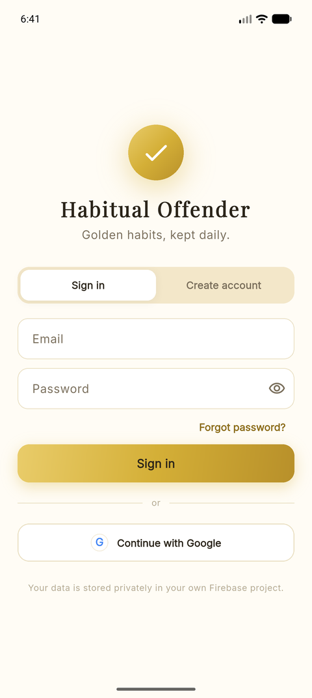
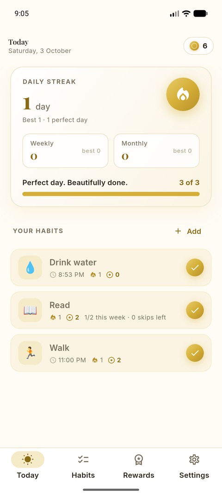
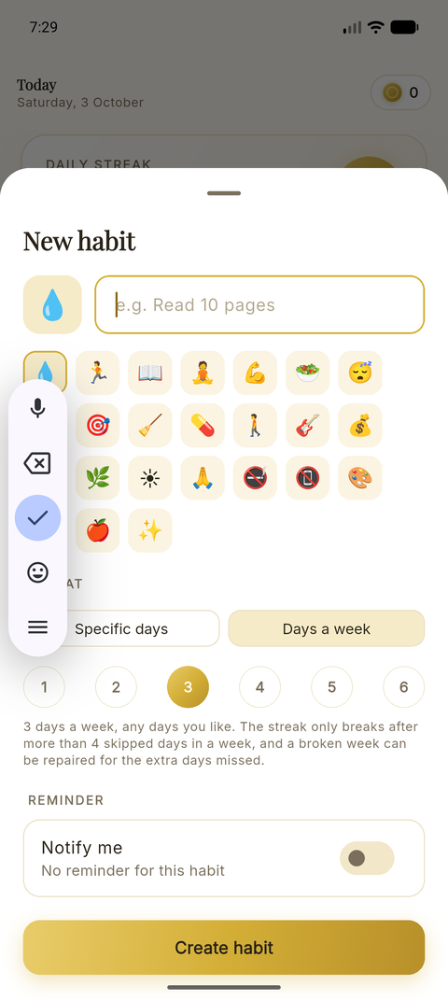
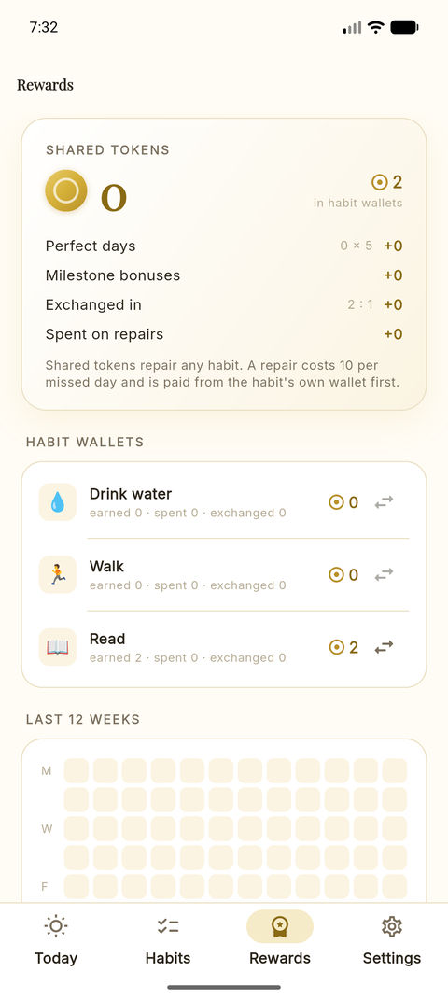
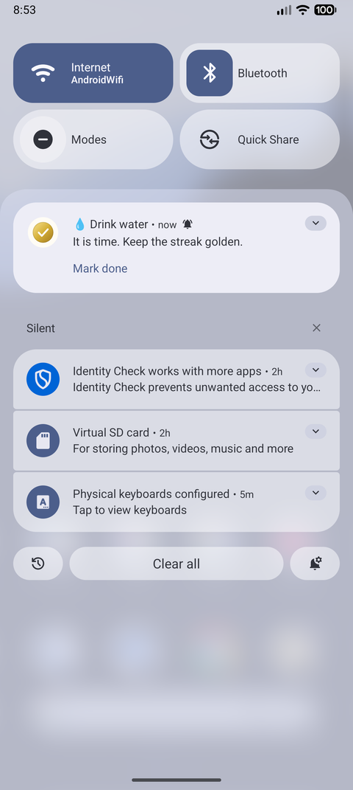
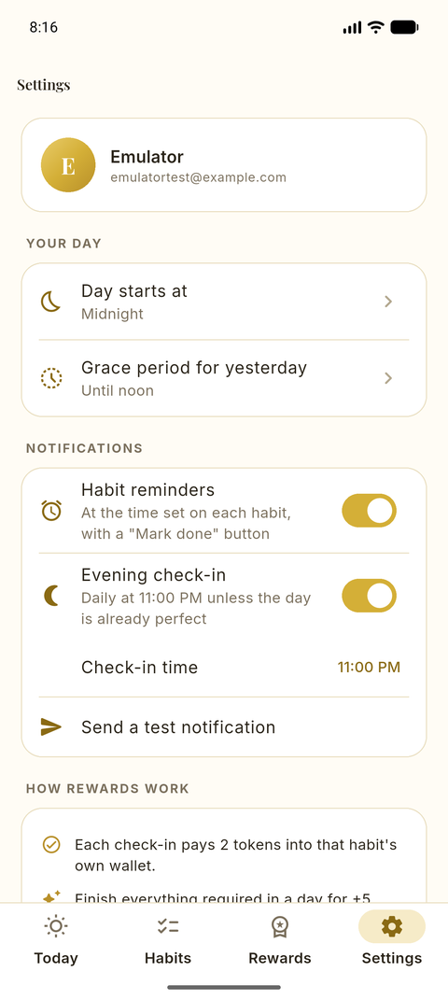
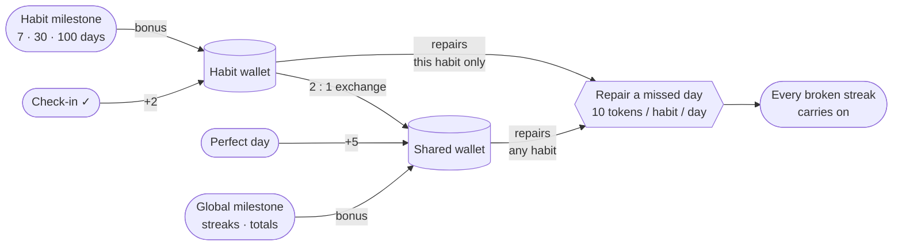

<!--
  Replace OWNER/REPO below with your GitHub path (one find-and-replace) so the
  dynamic badges and release links resolve.
-->
<div align="center">


# Habitual Offender

**A gold‑and‑white habit tracker for Android with two kinds of tokens, guilt‑free streak repairs and reminders that actually get things done.**

[](https://github.com/OWNER/REPO/actions/workflows/ci.yml)
[](https://github.com/OWNER/REPO/releases/latest)
[](https://github.com/OWNER/REPO/commits/main)
[](LICENSE)
<br/>
[](https://flutter.dev)
[](https://dart.dev)
[](https://firebase.google.com)
[](#install)

[**Download APK**](https://github.com/OWNER/REPO/releases/latest) · [Features](#features) · [How the rewards work](#how-the-rewards-work) · [Setup](#setup) · [Architecture](#architecture)

</div>

---

<table align="center">
  <tr>
    <td align="center"><br/><sub>Sign in</sub></td>
    <td align="center"><br/><sub>Today</sub></td>
    <td align="center"><br/><sub>New habit</sub></td>
  </tr>
  <tr>
    <td align="center"><br/><sub>Rewards</sub></td>
    <td align="center"><br/><sub>Reminder</sub></td>
    <td align="center"><br/><sub>Settings</sub></td>
  </tr>
</table>

## Why

Most habit apps punish a single missed day by zeroing a streak you spent months building. Habitual Offender assumes you will slip, and makes recovery part of the game: every check‑in earns tokens, and tokens buy back missed days. Runs entirely on free tiers, keeps your data in **your own** Firebase project, and never talks to a server for reminders.

## Features

| | |
|---|---|
| 🔐 **Accounts** | Email/password and Google sign‑in (Firebase Auth), password reset, account deletion |
| 📅 **Two schedule types** | *Specific days* (required on chosen weekdays) or *n days a week* (any days; the streak only breaks after more than `7 − n` skips in a week) |
| 🔔 **Reminders that work** | Exact on‑device alarms with a **Mark done** button that writes the check‑in even when the app is closed. Weekly habits go quiet once the week's target is met. Optional evening check‑in |
| 🔥 **Four streaks** | Per habit, daily (perfect days), weekly and monthly, all derived from raw records on every change so nothing can drift |
| 🪙 **Two‑tier tokens** | A wallet per habit plus a shared wallet; one‑way 2 : 1 exchange |
| 🛠️ **Guilt‑free repairs** | Buy back a missed day for 10 tokens per habit, habit wallet first, within 7 days. Weekly habits repair only the *extra* skipped days |
| 🏆 **Milestones** | One‑time bonuses with a celebration: 3 → 365‑day streaks, 2 → 52 perfect weeks, 1 → 12 perfect months, check‑in totals, and 7/30/100‑day tiers per habit |
| 🌙 **Your day, your rules** | Choose when a day starts (midnight to 5 AM) and a grace period for ticking yesterday's habits for free |
| 📊 **Rewards tab** | Balance breakdown, every habit wallet, tappable 12‑week heatmap, lifetime stats, milestone progress |
| ✨ **Details** | Drag to reorder, any emoji from the keyboard, haptics, bundled fonts, JSON export, offline‑first |

## How the rewards work



<details>
<summary><b>Streak rules in detail</b></summary>

- **Weekday habit**: required on each selected weekday. Miss one and the habit streak and the day's perfect‑day streak break, unless repaired.
- **Days‑a‑week habit** with target *n*: do it any day. You may skip `7 − n` days per calendar week (Mon–Sun). Once the skips are used the habit shows **DUE** every remaining day; missing a due day breaks the streak. A week with a shortfall of *k* days is repaired for `k × 10` tokens.
- **Daily streak**: consecutive days where everything required was done. Rest days (nothing required) are neutral. A voluntary check‑in on a rest day counts as a perfect day.
- **Weekly / monthly streaks**: whole calendar weeks / months with no missed day.
- **Grace period**: yesterday stays "open" for a configurable window (default until noon), so forgetting to tick costs nothing. After that, a repair costs tokens.
- **Day boundary**: with "Day starts at 3 AM", a check‑in at 00:30 counts for the previous day.
- **Repairs** are paid from the habit's own wallet first, then from the shared wallet. Repaired days keep streaks but do not earn the perfect‑day bonus.
- **Exchanges** are one‑way. Unticking a check‑in whose tokens were already exchanged or spent is refused.

</details>

<details>
<summary><b>Milestone table</b></summary>

| Kind | Thresholds → shared tokens |
|---|---|
| Daily streak | 3 → 10 · 7 → 25 · 14 → 40 · 21 → 60 · 30 → 100 · 50 → 150 · 100 → 300 · 200 → 500 · 365 → 1000 |
| Perfect weeks | 2 → 30 · 4 → 50 · 8 → 100 · 12 → 150 · 26 → 300 · 52 → 750 |
| Perfect months | 1 → 75 · 3 → 200 · 6 → 400 · 12 → 1000 |
| Check‑ins | 10 → 10 · 50 → 30 · 100 → 50 · 250 → 100 · 500 → 200 · 1000 → 500 |
| Per habit (to its wallet) | 7 → 10 · 30 → 40 · 100 → 150 |

All numbers live in [`lib/core/rewards.dart`](lib/core/rewards.dart).

</details>

## Install

Grab the latest `*-arm64.apk` from [**Releases**](https://github.com/lakshgupta8/habit-tracker/releases/latest) and open it on your phone (allow installs from that source once). Prebuilt APKs point at the author's Firebase project; to run against your own, build from source.

## Setup

Building from source needs a free Firebase project. About ten minutes.

<details open>
<summary><b>1 · Firebase project</b></summary>

1. [console.firebase.google.com](https://console.firebase.google.com) → **Add project** (Spark plan, no billing).
2. **Add app → Android**, package name `com.lakshya.habitual_offender` (or change it in `android/app/build.gradle.kts`). Add your debug SHA‑1:
   ```bash
   cd android && ./gradlew signingReport      # Windows: .\gradlew.bat signingReport
   ```
3. **Authentication → Sign‑in method**: enable **Email/Password** and **Google**.
4. Download `google-services.json` **after** enabling Google (it then contains the OAuth clients) into `android/app/`.
5. **Firestore Database → Create database**, then paste [`firestore.rules`](firestore.rules) into the Rules tab and **Publish**.

</details>

<details open>
<summary><b>2 · Local config</b></summary>

```bash
cp lib/firebase_options.example.dart lib/firebase_options.dart
# fill in apiKey, appId, messagingSenderId, projectId, storageBucket from
# Firebase → Project settings → Your apps → Android
# (or: dart pub global activate flutterfire_cli && flutterfire configure)
```

Both files are git‑ignored. The Google web client ID is read from `google-services.json`; you can pin it in `lib/app_config.dart` instead.

</details>

<details open>
<summary><b>3 · Run</b></summary>

```bash
flutter pub get
flutter run                                   # device or emulator
flutter build apk --release --split-per-abi   # → build/app/outputs/flutter-apk/
```

Release builds sign with the debug key, which is fine for personal use. Add a real keystore via `android/key.properties` before publishing, and register its SHA‑1 in Firebase or Google sign‑in will stop working.

</details>

## Architecture

```
lib/
├── main.dart · app.dart                Firebase + notifications bootstrap, auth gate
├── app_config.dart                     app name, optional Google web client ID
├── firebase_options.example.dart       template for the git-ignored real file
├── core/
│   ├── dates.dart                      local day keys, week/month keys, day boundary
│   ├── rewards.dart                    token rules and milestone table
│   └── theme/app_theme.dart            gold-white Material 3 theme, bundled fonts
└── features/
    ├── auth/                           AuthService, sign-in and setup screens
    ├── notifications/                  scheduled alarms, "Mark done" background handler
    └── habits/
        ├── models/                     Habit, DayRecord, WeekRecord, UserProfile
        ├── engine/streak_engine.dart   pure derivation of streaks, wallets, repairs, milestones
        ├── data/                       Firestore repository and live controller
        ├── screens/                    Today · Habits · Rewards · Settings · editor
        └── widgets/                    tiles, repair cards, heatmap, exchange, celebration
test/                                   engine unit tests + widget overflow tests
tool/gen_icon.dart                      regenerates the launcher icon PNGs
```

**Everything is derived.** The engine turns raw check‑ins, repairs and settings into every number on screen on each change, so there are no counters to get out of sync and the whole reward system is unit‑tested in isolation.

<details>
<summary><b>Firestore data model</b></summary>

```
users/{uid}                        email, displayName, settings,
                                   milestones{key: {reward, title, at}},
                                   exchanged{habitId: habitTokens}
users/{uid}/habits/{habitId}       name, emoji, scheduleType, weekdays, timesPerWeek,
                                   reminderMinutes, createdOn, archivedOn, sortOrder
users/{uid}/days/{yyyy-MM-dd}      done[habitId], doneAt{habitId: ts},
                                   repairs{habitId: {internal, external}}
users/{uid}/weeks/{yyyy-MM-dd}     (Monday) repairs{habitId: {credits, payment}}
```

Rules allow each user to read and write only their own subtree.

</details>

## Development

```bash
flutter analyze
flutter test                                        # 27 tests
dart run tool/gen_icon.dart && dart run flutter_launcher_icons
```

CI runs analyze, tests and a release build on every push and attaches the arm64 APK as a workflow artifact.

## Roadmap

- [ ] Home‑screen widget with today's habits
- [ ] Per‑habit notes and photo proof
- [ ] Wear OS tile
- [ ] iOS build (the Dart side is platform‑agnostic; notifications need iOS wiring)

## License

[MIT](LICENSE). Fonts Inter and Playfair Display are bundled under the [SIL Open Font License](assets/fonts/OFL-Inter.txt).
